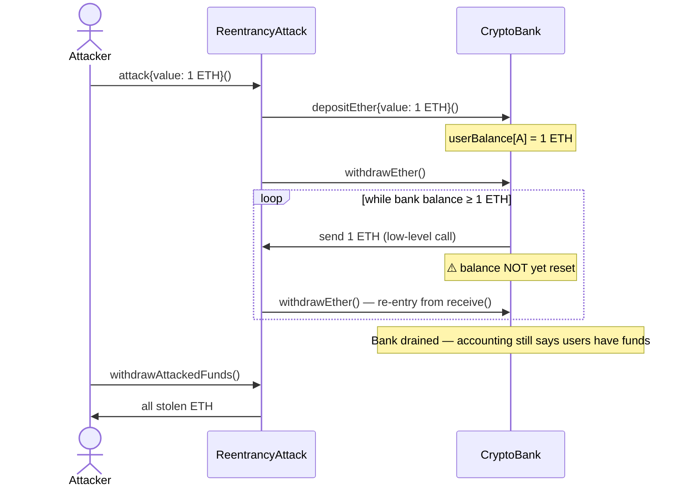

# Reentrancy Attack PoC

An educational proof of concept of the **reentrancy vulnerability** — the bug class behind The DAO hack — implemented end to end: an intentionally vulnerable ETH vault (`CryptoBank`), an attacker contract that drains it (`ReentrancyAttack`), and a Foundry test suite that demonstrates the exploit, its limits, and its impact on honest users.

> ⚠️ **For educational purposes only.** `CryptoBank` is intentionally insecure and must never be used in production.

Built with [Foundry](https://book.getfoundry.sh/) and [OpenZeppelin Contracts](https://www.openzeppelin.com/contracts) (`Ownable`), with full test coverage including fuzzing, and a GitHub Actions CI pipeline.

## How it works

The project is implemented with three main contracts:

1. [`CryptoBank`](https://github.com/davidvp-dev/reentrancy-attacks/blob/main/src/CryptoBank.sol): the victim. A simple ETH vault where users deposit (minimum 1 ETH) and withdraw their full balance. Its `withdrawEther` function sends the ETH **before** resetting the user's balance, violating the checks-effects-interactions pattern and lacking any reentrancy guard.
2. [`ReentrancyAttack`](https://github.com/davidvp-dev/reentrancy-attacks/blob/main/src/ReentrancyAttack.sol): the attacker. It deposits 1 ETH, calls `withdrawEther`, and from its `receive()` function keeps re-entering the bank while it still holds at least 1 ETH. Stolen funds can be collected by the owner.
3. [`ICryptoBank`](https://github.com/davidvp-dev/reentrancy-attacks/blob/main/src/interfaces/ICryptoBank.sol): minimal interface the attacker uses to talk to the bank.



**Why it works:** when the bank sends ETH to the attacker contract, control passes to its `receive()` function. At that moment `userBalance[attacker]` still holds the original deposit, so the bank's check passes again and sends another payment — repeated until the vault is empty.

**Impact on honest users:** after the attack, the bank's accounting still shows depositors with a balance, but the contract holds no ETH, so their withdrawals revert. The bank is left insolvent.

**Limit of this PoC:** the loop only succeeds cleanly when the bank's balance is a multiple of the attacker's deposit; otherwise the final nested call fails and the whole transaction reverts atomically (covered by a dedicated test).

**How to fix it:** update the user's balance *before* making the external call (checks-effects-interactions), and/or protect the function with OpenZeppelin's `ReentrancyGuard`.

## Technical docs

1. **Deposit ETH** — credits the caller's balance; reverts below 1 ETH. [Check function](https://github.com/davidvp-dev/reentrancy-attacks/blob/main/src/CryptoBank.sol#L19-L22)

```solidity
/**
 * @notice Deposits ETH into the bank, crediting it to the caller's balance.
 * @dev Reverts if `msg.value` is lower than 1 ETH.
 */
function depositEther() external payable;
```

2. **Withdraw ETH (vulnerable)** — sends the caller's full balance with a low-level call *before* resetting it to zero. [Check function](https://github.com/davidvp-dev/reentrancy-attacks/blob/main/src/CryptoBank.sol#L30-L38)

```solidity
/**
 * @notice Withdraws the caller's full balance.
 * @dev VULNERABLE: ETH is sent via a low-level call before the balance is reset,
 *      so a malicious `receive()` can re-enter this function and drain the bank.
 *      Reverts if the caller's balance is lower than 1 ETH or if the ETH transfer fails.
 */
function withdrawEther() external;
```

3. **Launch the attack** — deposits the attacker's ETH and triggers the first withdrawal. [Check function](https://github.com/davidvp-dev/reentrancy-attacks/blob/main/src/ReentrancyAttack.sol#L29-L33)

```solidity
/**
 * @notice Starts the attack: deposits `msg.value` and triggers the first withdrawal.
 * @dev Requires at least 1 ETH (the bank's minimum deposit). Subsequent withdrawals
 *      are triggered from `receive()`.
 */
function attack() external payable;
```

4. **Re-entry point** — executed every time the bank sends ETH to the attacker; re-enters while the bank holds at least 1 ETH. [Check function](https://github.com/davidvp-dev/reentrancy-attacks/blob/main/src/ReentrancyAttack.sol#L39-L43)

```solidity
receive() external payable;
```

5. **Collect stolen funds** — owner-only transfer of the drained ETH. [Check function](https://github.com/davidvp-dev/reentrancy-attacks/blob/main/src/ReentrancyAttack.sol#L49-L52)

```solidity
function withdrawAttackedFunds() external onlyOwner;
```

## Execution example

> Pending deployment — this section will be completed once the contracts are live on a testnet.

- Network: `<NETWORK>`
- CryptoBank address: `<CRYPTOBANK_ADDRESS>`
- ReentrancyAttack address: `<ATTACK_ADDRESS>`

Execution steps:

1. Deploy `CryptoBank`: `<TX_HASH>`
2. Honest users deposit ETH into the bank: `<TX_HASH>`
3. The attacker deploys `ReentrancyAttack`, pointing it at the bank: `<TX_HASH>`
4. The attacker calls `attack` with 1 ETH, draining the bank through reentrancy: `<TX_HASH>`
5. The attacker calls `withdrawAttackedFunds` to collect the stolen ETH: `<TX_HASH>`
6. An honest user tries to withdraw and the transaction reverts: `<TX_HASH>`

## Testing

The suite in [`test/ReentrancyAttackTest.t.sol`](https://github.com/davidvp-dev/reentrancy-attacks/blob/main/test/ReentrancyAttackTest.t.sol) covers:

- **Deployment** wiring and ownership.
- **Bank behavior** — happy paths and failure cases (deposits below 1 ETH, withdrawing without balance, receivers that reject ETH).
- **The exploit** — full drain, insolvency of honest users afterwards, an empty-bank edge case, and the atomic revert when the bank's balance isn't a multiple of the attacker's deposit.
- **Fuzzing** — for any whole-ETH amount of victim funds, the bank always ends up empty.
- **Access control** and failure handling when collecting stolen funds.

To run the tests:

```shell
forge test
```

To check coverage:

```shell
forge coverage
```

| File | % Lines | % Statements | % Branches | % Funcs |
|---|---|---|---|---|
| `src/CryptoBank.sol` | 100.00% (9/9) | 100.00% (8/8) | 100.00% (6/6) | 100.00% (2/2) |
| `src/ReentrancyAttack.sol` | 100.00% (12/12) | 100.00% (9/9) | 100.00% (5/5) | 100.00% (4/4) |
| **Total** | **100.00% (21/21)** | **100.00% (17/17)** | **100.00% (11/11)** | **100.00% (6/6)** |

## Contract addresses

> To be completed once deployed.

| Contract | Network | Address | Explorer |
|---|---|---|---|
| `CryptoBank.sol` | `<NETWORK>` | `<ADDRESS>` | `<EXPLORER_LINK>` |
| `ReentrancyAttack.sol` | `<NETWORK>` | `<ADDRESS>` | `<EXPLORER_LINK>` |

## License

MIT — see the SPDX identifier in the contract source.